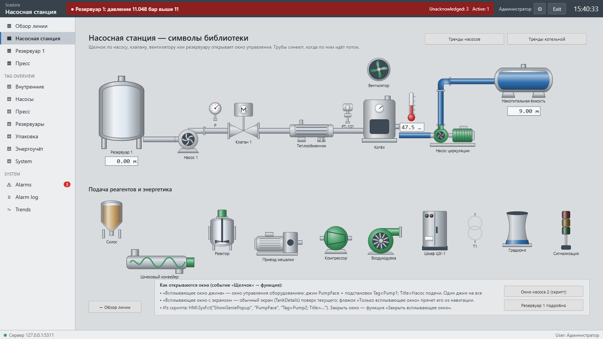
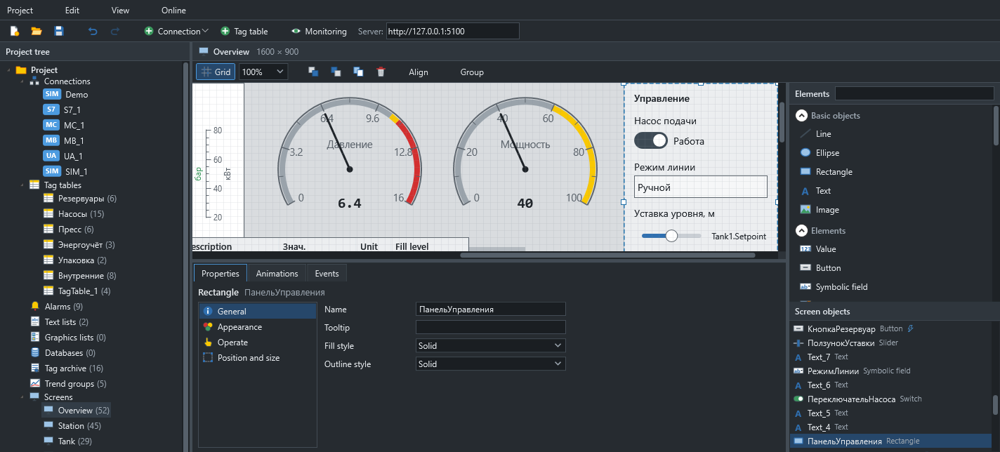
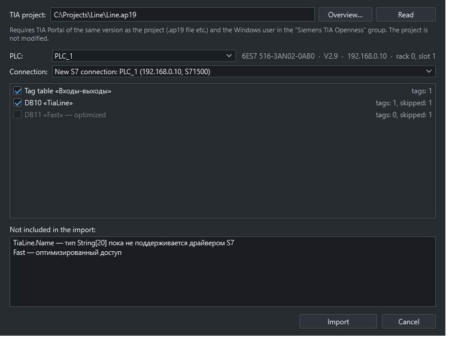
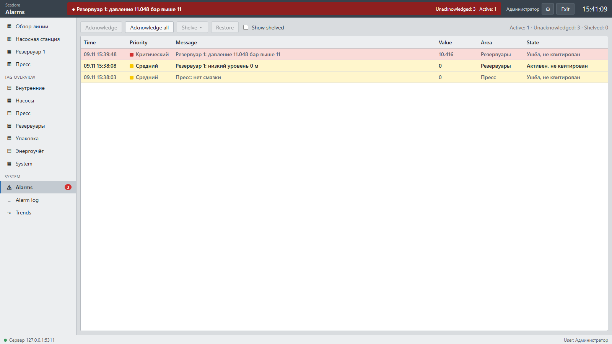
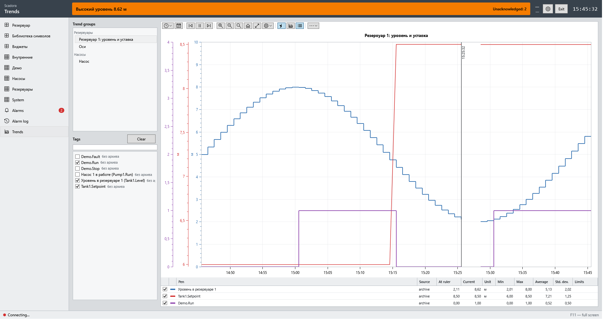
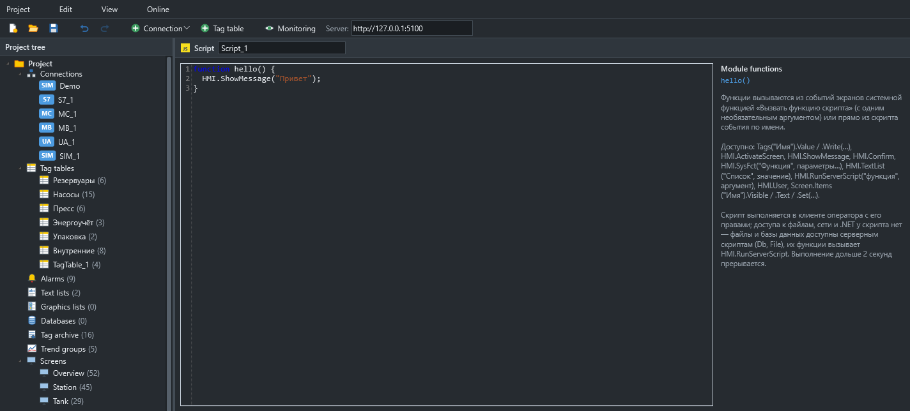

<p align="center">
  
</p>

<h1 align="center">Scadora</h1>

<p align="center">
  <b>Free SCADA and HMI software for Windows</b><br>
  Screen editor, server with PLC drivers, history, alarms, an operator station and a web HMI in one installer.
</p>

<p align="center">
  <a href="https://github.com/AnatoliiRavkov/scadora-releases/releases/latest"></a>
  <a href="https://github.com/AnatoliiRavkov/scadora-releases/releases"></a>
  
  
</p>

<p align="center">
  <a href="https://scadora.app"><b>Website</b></a> ·
  <a href="https://scadora.app/download/"><b>Download</b></a> ·
  <a href="https://scadora.app/docs/intro/"><b>Documentation</b></a> ·
  <a href="https://scadora.app/changelog/"><b>Changelog</b></a> ·
  <a href="#на-русском"><b>На русском</b></a>
</p>



This repository hosts **installers and release notes only**. Scadora is free to use, including commercially; its source code is closed.

## Download

| File | What it is |
| --- | --- |
| `Scadora-Setup-<version>.exe` | Installer: editor, server, operator station, web HMI, demo project, optional Windows service |
| `Scadora-<version>.zip` | Portable archive: unpack to a writable folder and run `ScadaRuntime.exe` |

Get the latest version from **[Releases](https://github.com/AnatoliiRavkov/scadora-releases/releases/latest)** or the **[download page](https://scadora.app/download/)**. Every release lists SHA-256 checksums. The files are not code-signed yet, so Windows SmartScreen may warn you: compare the checksum, then choose *More info → Run anyway*.

Once installed, Scadora checks for new versions itself and installs them only with your consent.

## What it does

| Area | Highlights |
| --- | --- |
| **Screen editor** | Drag-and-drop process screens, 312 industrial symbols in 19 categories, animations, events, genies with `%Tag%` parameters, undo/redo, live project check |
| **PLC connectivity** | Siemens S7-300/400/1200/1500, Modbus TCP, Mitsubishi Melsec (MC 3E), OPC UA, a built-in simulator, internal tags with Retain |
| **TIA Portal import** | Reads tags, data blocks, arrays, UDTs, strings and time types straight from a TIA Portal project, with no Excel export |
| **Alarms** | Digital and analog alarms, limits as numbers or tags, deadband, on/off delays, four priorities, acknowledgement, shelving, journal |
| **History and trends** | Deadband recording, trend groups, multiple axes, pen limits, statistics |
| **Scripting** | JavaScript on screens and on the server: tasks on schedule, conditions and tag changes, SQL databases via ODBC and SQLite, files; full control of every screen element |
| **Operator station** | Desktop program, plus a web HMI for browsers and phones on port 5101 |
| **Security** | Built-in users and roles independent of a Windows domain, per-tag write protection, audit log |
| **Operations** | Project edits apply without a restart, Windows service with restart on failure, project stored as a folder of text files that works with git |



| | |
| --- | --- |
|  |  |
| Tags straight from a TIA Portal project | Active alarms |
|  |  |
| Trends with several pens and axes | JavaScript editor |

## Requirements

| | |
| --- | --- |
| System | Windows 10, Windows 11 or Windows Server 2016 and later, 64-bit |
| .NET | Nothing to install, the runtime is included |
| Disk space | About 270 MB plus history and logs |
| Network | TCP 5100 for desktop clients, 5101 for browsers |
| TIA Portal import | Installed TIA Portal with Openness; tested on V19 |

## Quick start

1. Install Scadora and keep the **Demo project** component selected.
2. Open **Scadora Runtime** from the Start menu and press **Start**. The demo runs on a simulator, so no PLC is needed.
3. Press **HMI** and sign in as `admin`. The single-use password is in `%ProgramData%\Scadora\initial-admin-password.txt`; you will set a new one at first sign-in.
4. Open `http://127.0.0.1:5101` in a browser to see the same screens in the web HMI.
5. Use **Open demo project in the editor** from the Start menu to see how it is built. Edits apply to the running server immediately.

Full guide: **[Quick start](https://scadora.app/docs/quickstart/)**.

## A taste of scripting

```js
// Button script on a screen
if (!HMI.Confirm("Start pump 1?")) return;
if (Tags("Pump1.Fault").Quality !== "Good" || Tags("Pump1.Fault").Value) {
  HMI.ShowMessage("Start blocked: fault or no communication");
  return;
}
Tags("Pump1.Start").Write(true);
Screen.Items("Pump1").Children("Body").Fill = "#3C9A5F";
```

```js
// Server script: shift report into SQLite, run daily at 08:00
Db.Execute("Journal", "INSERT INTO Shift(Time, Total) VALUES(?, ?)", [Server.Now, Tags("Line.Count").Value]);
Tags("Line.Count").Write(0);
```

See **[Scripting basics](https://scadora.app/docs/scripts/)**, the **[API reference](https://scadora.app/docs/script-api/)** and **[examples](https://scadora.app/docs/script-recipes/)**.

## Documentation

- [What is Scadora](https://scadora.app/docs/intro/) · [Installation](https://scadora.app/docs/install/) · [Quick start](https://scadora.app/docs/quickstart/)
- [Connections and addresses](https://scadora.app/docs/connections/) · [Tags](https://scadora.app/docs/tags/) · [TIA Portal import](https://scadora.app/docs/tia-import/)
- [Screen editor](https://scadora.app/docs/screens/) · [Animations](https://scadora.app/docs/animations/) · [Events and functions](https://scadora.app/docs/events/) · [Genies](https://scadora.app/docs/genies/)
- [Scripting](https://scadora.app/docs/scripts/) · [Elements from scripts](https://scadora.app/docs/script-elements/) · [Server scripts](https://scadora.app/docs/script-server/) · [Debugging](https://scadora.app/docs/script-debugging/)
- [Alarms](https://scadora.app/docs/alarms/) · [History and trends](https://scadora.app/docs/trends/) · [Runtime and service](https://scadora.app/docs/runtime/) · [Web HMI](https://scadora.app/docs/web-hmi/) · [Security](https://scadora.app/docs/security/)

## Good to know

- Traffic between the server and clients is **not encrypted** yet: use Scadora on an isolated plant network.
- Scadora is not meant for emergency protection or safety functions; those belong in the PLC.
- It is a young product under active development, so test it on a bench before commissioning.

## Feedback

Found a bug or missing a feature? Open an **[issue](https://github.com/AnatoliiRavkov/scadora-releases/issues)** and include the version, what you did and what happened. For crashes, attach the log from `%ProgramData%\Scadora\logs`.

## License

Scadora is free of charge for any use, including commercial. The source code is closed. See the **[terms of use](https://scadora.app/license/)**. Third-party components are listed in `THIRD-PARTY-NOTICES.txt` in the program folder.

---

## На русском

**Scadora** — бесплатная SCADA и HMI для Windows: редактор мнемосхем, сервер с драйверами контроллеров, архив, алармы, рабочее место оператора и веб-HMI в одном инсталляторе. Здесь лежат только инсталляторы и описания версий. Программа бесплатна, в том числе для коммерческого использования, исходный код закрыт.

- **Скачать:** [последняя версия](https://github.com/AnatoliiRavkov/scadora-releases/releases/latest) или [страница загрузок](https://scadora.app/ru/download/).
- **Документация:** [scadora.app/ru/docs/intro/](https://scadora.app/ru/docs/intro/).
- **Что умеет:** Siemens S7, Modbus TCP, Melsec, OPC UA и симулятор; импорт тегов из TIA Portal без Excel; 312 промышленных символов; анимации, джины, алармы, тренды; скрипты JavaScript на экранах и на сервере; веб-HMI для браузера и телефона; свои пользователи и роли без домена Windows; обновление из программы с вашего согласия.
- **Требования:** Windows 10, 11 или Server 2016 и новее, 64 бита; .NET ставить не нужно.
- **Быстрый старт:** установите с демо-проектом, откройте «Scadora — среда исполнения», нажмите «Пуск», затем «HMI». Пароль первого входа для `admin` — в `%ProgramData%\Scadora\initial-admin-password.txt`.
- **Важно:** трафик между сервером и клиентами пока не шифруется, используйте изолированную сеть. Аварийные защиты должны выполняться в контроллере.
- **Ошибки и пожелания:** [Issues](https://github.com/AnatoliiRavkov/scadora-releases/issues), можно на русском.
- **Условия:** [scadora.app/ru/license/](https://scadora.app/ru/license/).
